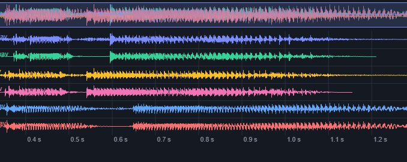

<!-- esasim: cover -->

<!-- /esasim: cover -->

# Text to Speech

**Type the words. Choose a voice. Hear it spoken, then make it sound like a phone call, a 1940s radio, a cathedral or a robot.**

Turn any text into natural speech with open text-to-speech models from Hugging Face, run on your own NVIDIA GPU or on any CPU. Pick one or more voices, press **Speak**, and listen to every take **before and after** the voice effects: 43 presets in five categories, plus sliders to fine-tune pitch, speed, reverb, echo, EQ and more. Every take can be downloaded as WAV or MP3.

     

## Overview

A text-to-speech model reads your text, works out how each word is pronounced, and produces a waveform of a voice saying it. Unlike the sound-effect models of *Text to Sound Generation*, these models are trained on speech: they **say the exact words you type**, such as *"Physical AI."*.

Each **voice** you choose gives its own take, so you can hear the same sentence from several speakers side by side. With Bark and MMS-TTS the **seed** changes the delivery too, so several takes per voice give you different readings to choose from.

The speech then goes through the **Voice filters**: a chain of studio effects (EQ, compression, distortion, bit crushing, chorus, phaser, echo, reverb, ring modulation, tremolo, tape hiss, vinyl crackle) arranged into ready-made presets. You can render one take through several presets at once to compare them.

**Text → speech takes (one per voice and seed) → voice effects → original and filtered players, waveforms and tables.**

The models download from Hugging Face into the worker's cache on first use and run on that machine. No hosted speech API is used. Takes already spoken with the same settings are kept in the worker's cache, so changing only the effects is almost instant.

## Flows

### 1 · Speak and filter

[**Open the blueprint →**](https://esacode.com/app/projects/33/flows/116)

| Block | What it does |
|---|---|
| **START HERE · Text, voice, effects & Speak** | The Text to Speech Studio. Type the text and choose the model, voices and where it runs, then the effect category, preset and any presets to compare. Fine-tune with sliders and press **▶ Speak**. Shows live progress. |
| **1 · Text to speech** | Runs the chosen model on the GPU or the CPU and writes one WAV (with an MP3 copy) per voice and seed, plus a table and a manifest. |
| **2 · Voice filters** | Applies the preset and your adjustments to every take, or every comparison preset to every take. |
| **3a · Original takes** | A player and **Download WAV / MP3** buttons for each take as the model made it. |
| **3b · Filtered takes** | The same for each take after the effects. |
| **4 · Waveforms (filtered)** | Zoom, scroll and play the filtered signals. |
| **5a · Takes** | Voice, seed, speed, duration, sample rate, device and whether it came from the cache. |
| **5b · Filter chain** | The exact chain of effects applied to every file. |

## The models

| Model | Hugging Face repository | Voices | Best for | Licence |
|---|---|---|---|---|
| **Kokoro 82M** · default | [hexgrad/Kokoro-82M](https://huggingface.co/hexgrad/Kokoro-82M) | American and British male and female voices, plus Italian, French, Spanish, Portuguese (BR) and Hindi | Natural, clear narration; fast even on a CPU | Apache-2.0 |
| **Bark small** | [suno/bark-small](https://huggingface.co/suno/bark-small) | 10 speakers each in English, Italian, French, German and Spanish | Expressive delivery that changes with every seed; `[laughs]`, `[sighs]`, `…` in the text | MIT |
| **Bark** | [suno/bark](https://huggingface.co/suno/bark) | as Bark small | Richer than Bark small, slower | MIT |
| **MMS-TTS** | [facebook/mms-tts-eng](https://huggingface.co/facebook/mms-tts-eng) and the other `mms-tts-<lang>` repositories | One voice per language, chosen by its ISO 639-3 code (`eng`, `ita`, `fra`, `deu`, `spa` …) | Light and fast; 1,100+ languages | CC-BY-NC-4.0 (non-commercial) |

**Which one?** For the cleanest result, Kokoro. For acting, emotion and a different reading on each take, Bark on a GPU. For a language Kokoro and Bark do not speak, MMS-TTS.

**Default demo:** Kokoro says *"Physical AI."* with three male voices (Michael, Adam, George), and the **Studio voice** effect is applied to each.

## The effects

Pick a **Category**, then a **Preset**: a line under the dropdowns says what it sounds like. Use **Compare with…** to add more presets. Every take is then rendered through each of them.

| Category | Presets |
|---|---|
| **Clean & broadcast** | None · Studio voice · Podcast · Broadcast announcer · Warm narrator · Whisper-soft |
| **Devices** | Telephone · Mobile call · AM radio · Old radio (1940s) · Vinyl record · Walkie-talkie · Intercom · Drive-thru speaker · Megaphone · Stadium PA · Space helmet |
| **Spaces** | Small room · Bathroom · Concert hall · Cathedral · Cave · Canyon echo · Distant voice · Next room · Underwater |
| **Characters & sci-fi** | Deep voice · Giant · Demon · Robot · Cyborg · Alien · Ghost · Chipmunk · Helium · Sci-fi computer |
| **Creative & lo-fi** | Lo-fi · 8-bit arcade · Dreamy · Slow motion · Fast forward · Tremolo · Phaser sweep |

**Fine-tune** adds your own adjustments on top of the preset. Pitch and gain add to the preset's values; the others replace them.

| Sliders | Toggles |
|---|---|
| Pitch · Speed (same pitch) · Reverb · Echo delay · Echo feedback · Low cut · High cut · Distortion · Robot (ring modulation) · Tremolo · Tape hiss · Gain | Chorus · Phaser · Vinyl crackle · Compressor |

Double-click a slider to reset it; **Reset fine-tuning** resets them all. The effects run in this order: trim silence → speed → pitch → low/high cut → ring modulation → tremolo → distortion → bit crush → chorus → phaser → echo → reverb → compressor → gain → hiss and crackle → normalize → fades.

## Where it runs

- **NVIDIA GPU:** used when PyTorch sees a CUDA GPU (Bark in half precision). Recommended for Bark.
- **CPU:** fully supported. Kokoro and MMS-TTS are quick on a CPU. Bark works but is much slower.
- **Run on** in the Studio: **Auto** uses a GPU if the machine has one, otherwise the CPU. **NVIDIA GPU** sends the run only to machines with one and stops with an explanation if PyTorch cannot see it there. **CPU** never uses the GPU.
- **Voice filters** always run on the CPU (Spotify's open-source *pedalboard*), on the same machine as the speech.
- **Cache:** model weights go into the worker's Hugging Face cache, and finished takes into its `tts-takes` cache. Both are reused by later runs.

## What you need

1. An EsaSim worker available to this project under **Compute**. Any CPU works; an NVIDIA GPU helps for Bark.
2. Internet access the first time, for:
   - the Python packages (about a minute): PyTorch, Transformers 4.47, Kokoro and its phonemizer (espeak-ng, spaCy), pedalboard, SoundFile;
   - the English language model of spaCy, downloaded by Kokoro on its first English take;
   - the model weights from Hugging Face.

   Later runs reuse them.
3. No account or key: all the models are public. A Hugging Face token can be set on the **Text to speech** block if you hit download rate limits.

## How to run it

1. Under **Compute**, check that a machine is available for this project.
2. Open [**1 · Speak and filter**](https://esacode.com/app/projects/33/flows/116) and switch to **View**. Find the **Text to Speech Studio**.
3. **Text & voice:** type exactly the words to say. Choose the **Model** and **Run on**, and add voices from **Add a voice**. Each voice appears as a chip; × removes it.
4. **Effects:** choose a **Category** and a **Preset**. Optionally add presets with **Compare with…** and open **Fine-tune** for your own adjustments.
5. Press **▶ Speak** (or **Ctrl+Enter** in the text box). The View starts a run with these settings for that run only. You don't need to edit the Blueprint.
6. Follow the progress bar. When the run ends, listen in **3a · Original** and **3b · Filtered** and download the WAV or MP3 of any take.
7. To try other effects on the same speech, change them and press **Re-apply effects**. The takes come from the cache, so only the effects are computed again.

Your text and choices stay in the Studio between runs. A new run can start once the previous one has finished. A normal Blueprint **Run** also works: it speaks with the settings stored on the blocks.

## Settings worth knowing

| Setting | Meaning |
|---|---|
| **Model** | Kokoro 82M, Bark small, Bark or MMS-TTS. |
| **Voices** | One or more voices; each gives a take. Kokoro voice names start with the language (`a` American, `b` British, `i` Italian, `f` French, `e` Spanish, `p` Portuguese, `h` Hindi) and the gender (`f` / `m`), e.g. `am_michael`. |
| **Takes per voice** | Extra takes from consecutive seeds. Bark and MMS-TTS read differently on each seed. Kokoro gives the same take for the same voice and speed. |
| **First seed** | Take 1 uses this seed, take 2 the next, and so on; **0** picks a random start. |
| **Speaking speed** | Speed of the model's own reading (Kokoro and MMS-TTS). For Bark, use the effects' **Speed** slider. |
| **Run on** | Auto, NVIDIA GPU or CPU, as above. |
| **Reuse takes** (block setting) | On by default: a take already made with the same model, voice, text, speed and seed comes from the cache. |
| **Trim, normalize, fades** (Voice filters block) | Silence trimmed at both ends, peak at −1 dBFS, 10 ms fade-in and 50 ms fade-out by default. |

**Tips for better speech:** write the text the way it should be said. Spell out abbreviations if needed ("A.I." or "AI"), use punctuation for pauses, and keep each sentence reasonably short. With Bark, `…` adds hesitation and `[laughs]` or `[sighs]` add non-verbal sounds.

## What you get

Each run produces:

- **Original takes**: `speech_01_am-michael_seed1.wav` and so on, 16-bit PCM, with an MP3 copy of each. Kokoro and Bark take are at 24 kHz, MMS-TTS at 16 kHz.
- **Filtered takes**: the same names with the preset added, e.g. `speech_01_am-michael_seed1_fx-studio-voice.wav`, again with MP3 copies. With comparisons, one file per take and preset.
- **`takes.csv`**: one row per take with voice, seed, speed, duration, sample rate, generation time, device and whether it came from the cache.
- **`filters.csv`**: one row per filtered file with its preset and the full effect chain.
- **`speech.json`**: the model, repository, text, voices, seeds, device, load time, library versions and licence notes, to make the same takes again.

## Models, licensing and responsible use

- **Kokoro 82M**, [huggingface.co/hexgrad/Kokoro-82M](https://huggingface.co/hexgrad/Kokoro-82M): Apache-2.0.
- **Bark** and **Bark small**, [huggingface.co/suno/bark](https://huggingface.co/suno/bark), [huggingface.co/suno/bark-small](https://huggingface.co/suno/bark-small): MIT.
- **MMS-TTS**, [huggingface.co/facebook/mms-tts](https://huggingface.co/facebook/mms-tts): CC-BY-NC-4.0, **non-commercial use only**.
- Effects: **pedalboard** by Spotify, GPL-3.0. Kokoro's pronunciation uses **misaki**, **espeak-ng** and **spaCy**.
- The code of the blocks is EsaSim's.

Review each model card before commercial use. These voices are synthetic: do not use them to impersonate a real person or to deceive listeners.

## Notes

- **Tested:** Kokoro 82M on a CPU, with three voices and the Studio voice effect: about 20 s to load the model, then about a second for each 2-second take. **Not yet tested here:** Bark and MMS-TTS, and generation on a GPU.
- **Server2 PC:** EsaSim lists its Tesla V100, but the worker's PyTorch cannot see it ("No CUDA GPUs are available"), so *Auto* falls back to the CPU there and *NVIDIA GPU* stops with that message. Check the NVIDIA driver on that machine. The GPU of *Gianluca De Novi PC* (RTX 3070) works with other projects.
- Kokoro's Japanese and Chinese voices need extra language packs and are not offered.
- MMS-TTS reads Latin-script languages directly; some languages in other scripts need romanisation first.
- The first run on a machine takes longer: it installs the packages and downloads the models.

---

Built with EsaSim · Open-model speech synthesis · Local compute · Voice effects

<!-- esasim: files of the project -->

---

An [EsaSim](https://esacode.com/) project of the workspace Gianluca De Novi's workspace (ai).

### Blueprints in this repository

- [1 · Speak and filter](blueprints/1-speak-and-filter.json) · 8 blocks · version 4

### Workspace blocks it uses

- [Text to Speech Studio](blocks/ws-text-to-speech-studio) · version 3
- [Text to speech](blocks/ws-text-to-speech) · version 2
- [Voice filters](blocks/ws-voice-filters) · version 4
- [Sound takes with downloads](blocks/ws-sound-takes-with-downloads) · version 2

### Assets

The files the project's views draw with (3D models, textures, sounds), in [assets/](assets/):

- [covers/cfe1a32f-9f8b-40eb-ae4b-d554d7bbbbd6.png](assets/covers/cfe1a32f-9f8b-40eb-ae4b-d554d7bbbbd6.png) · 95 KB

Keys pasted in blocks (secret settings) are not saved here, nor are the team and the results of runs.
